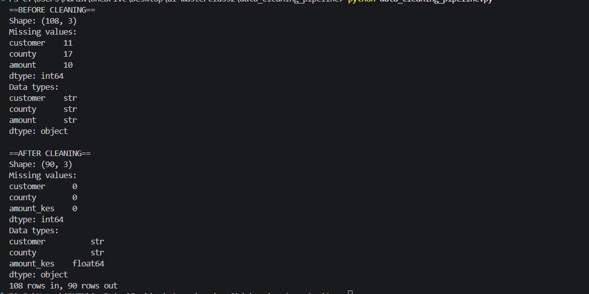

# Messy Business Data Cleaning Pipeline

A reusable pandas pipeline that cleans a messy sales dataset (Kenyan counties, amounts in KES) and documents every cleaning decision.

## What it does

`data_cleaning_pipeline.py` reads `messy_sales.csv`, standardizes the formats, applies a missing-value policy, removes duplicates and writes `clean_sales.csv`.

**Result:** 108 rows in, 90 rows out.



## How to run

```bash     
python data_cleaning_pipeline.py   # creates clean_sales.csv
```

To clean your own file, change the paths in the last line of `data_cleaning_pipeline.py`:

```python
run_pipeline("your_input.csv", "your_output.csv")
```

## Pipeline steps (in order)

The order matters: formats are standardized first, so the missing-value and duplicate steps work on consistent data.

| Step | Function | Decision | Why |
|------|----------|----------|-----|
| 1 | `clean_county` | Trim spaces, fix capitalization, expand abbreviations (`nrb` -> Nairobi, `msa` -> Mombasa, ...), map Eldoret to Uasin Gishu | One place should have one name, or counts and totals get split |
| 2 | `clean_customer` | Strip extra spaces from names | `" Achieng "` and `"Achieng"` must match for duplicate detection |
| 3 | `clean_amount` | Remove `KES`/`Ksh` and commas, convert to a number (`amount_kes`), drop the raw text column | Amounts stored as text can't be summed or averaged |
| 4 | `handle_missing_data` | Missing county -> `"Unknown"`; missing customer -> `"Walk-in Customer"`; missing amount -> **drop the row** | The sale still happened, so we keep county and customer rows; a sale without an amount can't be analyzed |
| 5 | `remove_duplicates` | Remove rows identical in every column | Duplicates inflate totals; matching on all columns avoids deleting genuine repeat sales |

## What was removed

| Reason | Rows |
|--------|------|
| Missing amount | 10 |
| Exact duplicates | ~8 |
| **Total removed** | **18** |

## Files

- `data_cleaning_pipeline.py`: the cleaning pipeline
- `messy_sales.csv`: input (dirty)
- `clean_sales.csv`: output (clean)
- `image.png`: Terminal screenshot
